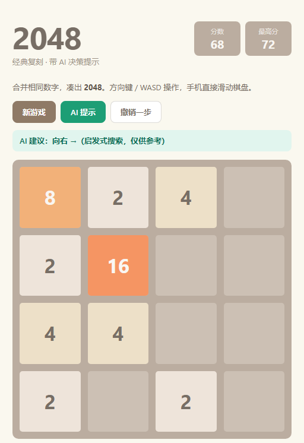

# 2048 · AI 提示版

> 经典 2048 复刻，额外提供一个基于 expectimax 搜索的「AI 提示」。纯 HTML / CSS / JavaScript，零依赖、零构建，双击即玩。

**在线试玩**：https://lkzzkl.github.io/2048-ai-hint/ · **源码**：https://github.com/lkzzkl/2048-ai-hint



## 玩法

用方向键或滑动让所有方块朝一个方向移动，两个相同数字相撞会合并成它们的和，得分等于新方块的数值。每次有效移动后随机出现一个 `2`（90%）或 `4`（10%）。凑出 **2048** 即获胜；棋盘填满且无可合并的相邻方块时游戏结束。

| 操作 | 输入 |
| --- | --- |
| 移动 | `↑ ↓ ← →` / `W A S D` / 触屏滑动 |
| 撤销一步 | `U` / `Ctrl + Z` / 「撤销一步」按钮（最多回溯 30 步） |
| 重新开局 | 「新游戏」按钮 |
| AI 建议 | 「AI 提示」按钮 |

## 实现要点

- **完整规则**：一次移动内每个方块最多合并一次，`[2,2,2,2] → [4,4,0,0]` 而不是 `[8,0,0,0]`；无位移时不生成新方块。
- **状态与持久化**：分数、最高分（`localStorage`）、撤销栈、胜利 / 失败 / 继续挑战状态分离，最高分不因撤销而回退。
- **AI 提示**：`expectimax` 搜索（深度 2）枚举四个方向，对随机新方块做概率展开，用启发式函数评估局面 —— 鼓励空格数量、大数字聚在左上角（蛇形权重）、相邻数值平滑、最大块更大。为控制延迟，概率节点最多采样 6 个空格，单次点击耗时在毫秒级。
- **可测试性**：纯逻辑 `Game2048` 与浏览器 UI 分层在同一文件中，逻辑部分通过 `module.exports` 暴露，随机源可注入（`rng`），因此 `move` 是纯函数、不修改输入棋盘。
- **体验细节**：键盘与触屏双输入、响应式棋盘、合并 / 新生方块动画、`prefers-reduced-motion` 降级、键盘焦点可见样式。

> 提示功能**只给方向建议，不替玩家走棋**：保留决策权，也避免「自动通关」破坏游戏本身的乐趣。

## 项目结构

```
2048-ai-hint/
├── index.html            # 页面结构
├── style.css             # 棋盘、配色、动画、响应式
├── game.js               # 纯逻辑 Game2048 + 浏览器 UI（DOM 守卫隔离）
├── tests/logic.test.js   # Node 内置 test runner 单元测试
├── assets/screenshot.png # 游戏界面截图
├── README.md
├── .gitignore
└── LICENSE
```

## 本地运行

```bash
# 方式一：直接用浏览器打开 index.html
# 方式二：起一个静态服务器（推荐，行为与线上一致）
python -m http.server 8000
# 浏览器访问 http://localhost:8000
```

## 测试

```bash
node --test tests/logic.test.js
```

10 个用例覆盖：合并规则与禁止连锁合并、四个方向的移动结果、得分、输入不可变、初始棋盘、随机源可注入、胜利 / 失败判定、AI 建议的合法性与死局返回 `null`。当前结果 **10 passed, 0 failed**（Node v22）。

## 设计取舍与 AI 协作复盘

| 决策 | 理由 |
| --- | --- |
| 单页零依赖，不用 React / Vite | GitHub Pages 直接托管根目录静态文件，无构建产物、无依赖安装，出错面最小 |
| 逻辑与 UI 分层、逻辑可 `require` | 让核心规则能被自动化测试覆盖，而不是只靠手动试玩 |
| 随机源可注入 `rng` | 把不确定性变成可控输入，测试才能确定性断言 |
| 不接入大模型 API | 纯前端直连会明文暴露密钥；本地启发式搜索零成本、零隐私风险，且足够体现「AI 功能设计」 |
| 提示而非自动代走 | 产品取舍：AI 辅助决策优于 AI 替代决策，玩法主体仍是玩家 |

开发流程按「**先定验收清单 → 分模块生成 → 自动化测试 + 浏览器截图验收 → 工程化与规范化提交 → 部署回填链接**」推进，把需求描述、约束条件、验收标准前置，减少反复返工。

## License

[MIT](LICENSE)
